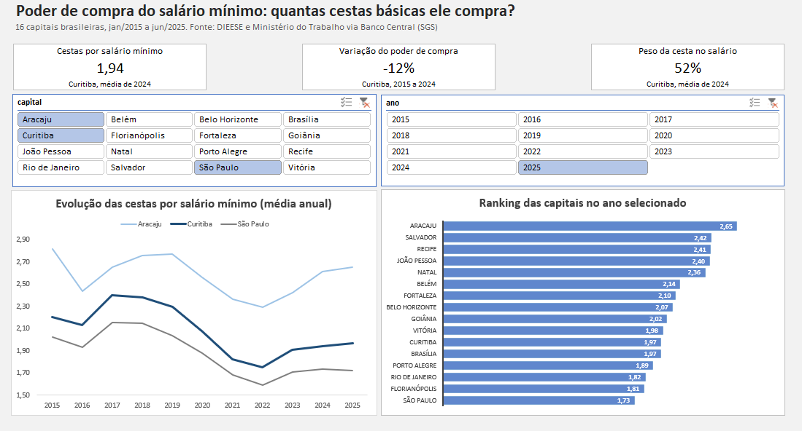
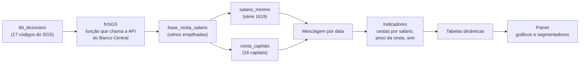

# Poder de compra do salário mínimo: quantas cestas básicas ele compra? (Excel)



## 📌 Sobre o projeto

Meus outros projetos de dados foram feitos em SQL, Python e Power BI, e faltava um em Excel, que é a ferramenta que a maioria das empresas realmente usa no dia a dia. Então montei este.

A ideia foi pegar uma pergunta simples e ver se os dados conseguiam respondê-la: **o salário mínimo compra mais ou menos cestas básicas hoje do que comprava em 2015?** E, de quebra, ver como isso muda de uma capital para outra.

Fiz tudo dentro do Excel: a coleta dos dados, a limpeza, os cálculos e o painel final.

## 🎯 Perguntas que o projeto responde

- O poder de compra do salário mínimo, medido em cestas básicas, melhorou ou piorou entre 2015 e 2025?
- Em qual momento foi pior?
- Como Curitiba, a única capital do Paraná na pesquisa, se compara às outras capitais?
- Quais capitais têm o melhor e o pior poder de compra hoje?

## 🗂️ Fontes de dados

Todos os dados vêm do Sistema Gerenciador de Séries Temporais (SGS) do Banco Central, que é aberto e tem API pública.

| Dado | Origem | Código no SGS |
|---|---|---|
| Valor mensal da cesta básica, 16 capitais | DIEESE | 7479 a 7494 |
| Salário mínimo mensal | Ministério do Trabalho | 1619 |

**Período:** janeiro de 2015 a junho de 2025 (126 meses).

A relação completa de códigos e capitais está na aba `dicionario` da planilha.

## 🛠️ Como foi feito

O fluxo dentro do Excel ficou assim:



Resumindo cada etapa:

1. **Coleta com Power Query.** Em vez de baixar 17 arquivos na mão, escrevi uma função (`fnSGS`) que recebe o código de uma série, consulta a API do Banco Central e devolve a tabela já tratada. Ela lê a lista de códigos da aba `dicionario` e roda uma vez para cada linha. Se a API falhar, a função tenta de novo sozinha, porque isso aconteceu algumas vezes durante o desenvolvimento.
2. **Tratamento.** Ajustei os tipos de dados (a API manda decimais com ponto, o Excel em português espera vírgula), separei o salário mínimo das capitais e cruzei os dois pela data.
3. **Indicadores.** Calculei duas métricas para cada capital e mês:
   - **Cestas por salário:** salário mínimo ÷ valor da cesta.
   - **Peso da cesta no salário:** valor da cesta ÷ salário mínimo.
4. **Painel.** Montei tabelas dinâmicas, gráficos dinâmicos e segmentadores (os botões de filtro) para o painel se atualizar sozinho quando o usuário clica.

Os três cartões do topo usam a função `MÉDIASES` direto sobre a base e ficam fixos em Curitiba, no ano de 2024.

## 🔍 O que os dados mostram

- **Em Curitiba, o poder de compra caiu cerca de 12% entre 2015 e 2024.** Em 2015, um salário mínimo comprava em média 2,20 cestas. Em 2024, 1,94. Nesse último ano, a cesta já consumia cerca de 52% do salário mínimo.
- **O pior momento foi 2022.** Curitiba chegou a 1,75 cesta por salário. Quase todas as capitais tiveram queda em 2021 e 2022, período que coincide com a alta dos preços dos alimentos, e depois se recuperaram só em parte.
- **Nenhuma das 16 capitais voltou ao nível de 2015.** Mesmo com a recuperação, a média de 2025 (que só tem 6 meses) ficou abaixo da de 2015 em todas elas.
- **Existe um recorte regional claro.** No ranking de 2025, as cinco primeiras posições são todas do Nordeste: Aracaju (2,65), Salvador (2,42), Recife (2,41), João Pessoa (2,40) e Natal (2,36). Na outra ponta ficam São Paulo (1,73), Florianópolis (1,81) e Rio de Janeiro (1,82). Como o salário mínimo é o mesmo no país inteiro, essa diferença vem toda do preço da cesta em cada cidade.
- **Curitiba aparece em 11º entre 16 capitais** em 2025, com 1,97 cesta por salário, empatada com Brasília.

## ⚠️ Limitações e pontos de atenção

Prefiro deixar claro o que o projeto **não** cobre:

- **Só capitais.** A pesquisa do DIEESE é feita em capitais, então cidades do interior do Paraná, como Maringá, não entram. Curitiba representa o estado, mas não dá para generalizar para o restante.
- **16 capitais, não todas.** A pesquisa passou a cobrir mais cidades recentemente, mas usei apenas as 16 que têm série mensal disponível no SGS no período analisado.
- **Os dados vão até junho de 2025.** As séries do SGS pararam de ser atualizadas nessa data, quando consultei. Por isso 2025 tem só 6 meses, e os cartões do painel usam 2024, o último ano completo, para a comparação com 2015 ser justa (12 meses contra 12).
- **Dois meses faltando.** As séries de Belo Horizonte e Brasília têm 125 meses em vez de 126. Não investiguei o motivo.
- **Um salto que não expliquei.** Em Aracaju, a cesta subiu cerca de 18% entre dezembro de 2015 e janeiro de 2016, bem acima do que aconteceu nas outras capitais, e isso puxa a queda de 2015 para 2016 na cidade. Pode ser variação real ou mudança na coleta, e não consegui confirmar qual das duas.
- **É só comida.** A cesta cobre alimentos para um adulto. Aluguel, transporte e outras despesas ficam de fora, então o indicador mostra um pedaço do custo de vida, não ele inteiro.
- **Não calculei horas de trabalho.** O DIEESE divulga a jornada necessária para comprar a cesta, mas usa o salário líquido e uma metodologia própria. Preferi não reproduzir uma conta parecida que daria números diferentes dos oficiais.
- **Sobre as cores do gráfico de linhas.** Formatei o painel com Aracaju, Curitiba e São Paulo selecionadas. Se você trocar as capitais no filtro, as cores das linhas podem não acompanhar a troca.

## ▶️ Como usar

1. Baixe o arquivo `excel/poder_compra_cesta_basica.xlsx`.
2. Abra no **Excel para desktop**. A versão online não tem todos os recursos do Power Query.
3. Na aba `painel`, clique nos botões de capital e de ano para filtrar os gráficos.
4. Para atualizar os dados, vá em **Dados > Atualizar Tudo**. É preciso estar conectado à internet.

A função que busca os dados tem o período fixado (de 01/01/2015 a 30/06/2025). Para mudar o intervalo, é só editar as datas na consulta `fnSGS`.

## ⚙️ Tecnologias utilizadas

- Excel (Power Query e linguagem M, tabelas dinâmicas, gráficos dinâmicos, segmentadores e fórmulas como `MÉDIASES`)
- API do Banco Central do Brasil (SGS)

## 📁 Estrutura do projeto

```
excel-poder-compra-cesta-basica/
├── excel/            # planilha com o projeto completo
├── imagens/          # print do painel
├── README.md
└── .gitignore
```

Não há pasta de dados porque a planilha busca tudo direto da API do Banco Central a cada atualização, sem arquivos intermediários.

## 👤 Autor

**Carlos Jaquis**